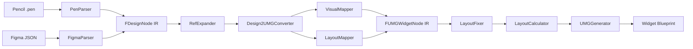

# Architecture

Design2UMG converts design-side documents into Unreal Engine 5 UMG Widget Blueprints through a layered, source-agnostic pipeline.

## Pipeline



## Core Boundaries

- `PenParser` and `FigmaParser` are the only places that may interpret format-specific fields.
- `FDesignNode` is the shared design IR. Everything after parsing must operate on IR, not on source-specific JSON.
- `FUMGWidgetNode` is the generation IR used by editor-side Blueprint construction.
- `Design2UMGConverter` owns source-to-UMG conversion orchestration, while specialized helpers handle grid layout, prototype navigation, source metadata, and text widget construction.

## Design Rules

### Parser responsibility stays in the parser

If a fidelity problem comes from source data semantics, fix the responsible parser instead of adding broad runtime branches in shared layers.

### Bounds are the source of truth

Layout repair and projection are driven by bounds. `LayoutFixer` adjusts bounds-level intent, and `LayoutCalculator` turns the final bounds into anchors and offsets.

### Typed data is the primary contract

Generated widget data should flow through typed structs (`TextStyle`, `WidgetStyle`, `Text`, `Brush`, `Effect`, `Path`, `Shadow`, `Render`, `WidgetState`, `ScrollBox`) rather than ad hoc legacy property maps.

### Verification is part of the architecture

The formal release gate is not just "does it render" but "does no admissible case regress against the tracked historical best." Refactors are only acceptable if the full gate remains non-regressing.

## Module Overview

| Module | Responsibility |
| --- | --- |
| `Design2UMGCore` | Editor module for parsing, IR definitions, conversion, layout logic, and fidelity-related shared helpers. It is not a runtime module; the Core name means shared editor/importer ownership, not runtime availability. |
| `Design2UMGEditor` | Import pipeline, Blueprint generation, preview/editor UI, automation rendering, editor-only asset workflows |
| `Tools/` | Batch verification, historical-best validation, snapshot wrappers, release governance helpers |

## Release Boundary

- The public release promise covers `.pen` import and Figma design import through REST or local export JSON.
- Bridge/debug workflows such as MCP JSON import remain available but are not treated as the primary release contract.
- Local maintainer workflow files such as `AGENTS.md`, `CLAUDE.md`, `.claude/`, and `.codex/` should remain untracked and are excluded from packaged release outputs.

## IR Data Flow

The pipeline uses two intermediate representations:

```
FDesignDocument  →  Design2UMGConverter  →  FUMGWidgetNode tree  →  UWidgetBlueprint
   (design IR)                                  (generation IR)
```

`FDesignDocument` is produced by parsers and holds source-agnostic design data. `FUMGWidgetNode` is produced by the converter and holds UMG-specific generation data. `UMGGenerator` consumes the node tree to produce the final Blueprint asset.

### FDesignNode children vs descendants

`FDesignNode::Children` is an ordered list of direct child nodes. `FDesignNode::Descendants` is a key-indexed lookup table for reusable nodes used during ref expansion — key format is either a slash-separated path (`"parentId/childId"`, resolved by recursive path traversal) or a bare node id (`"nodeId"`, resolved by full-tree id search); `RefExpander::ApplyDescendantOverride` selects the strategy based on whether the key contains `/`. `FDesignDocument::Children` is the root node list — same field name as `FDesignNode::Children` but different semantics. `FDesignDocument::FindReusableNode` traverses `Children` recursively and does not use `Descendants`.

### Parser decision fields in IR

Some fields such as `bPaddingRequiresRuntimeWrap` are set by the parser and consumed by the converter. This is intentional: the parser has access to source-format semantics (e.g. whether padding is already baked into child coordinates) that the converter cannot reconstruct. These fields represent parser decisions that must survive the IR boundary.

### Copy semantics

`FUMGWidgetNode` holds a `TUniquePtr<FUMGSourceNodeData>` and is move-only. It is a `USTRUCT`, and UHT-generated code does not support deep-copying `TUniquePtr` members, so copy construction is deleted. `FDesignNode` also holds a `TUniquePtr<FDesignSourceNodeData>` but implements a deep-copy constructor manually (see `DesignSchema.cpp`). The asymmetry is intentional: `FDesignNode` needs to be copyable for ref expansion, while `FUMGWidgetNode` does not.

## Extension Points

### Adding a new design source format

Implement a parser that produces a `FDesignDocument`. The required fields are `RootNodes` (the root node list) and `Fonts` (font metadata). Register the parser in `DesignSourceRegistry` (`Source/Design2UMGEditor/Private/Design2UMGEditorDesignSourceRegistry.cpp`).

Reference signatures:

```cpp
static bool FPenParser::ParseDocument(const FString& JsonString, FDesignDocument& OutDocument);
static bool FFigmaParser::ParseDocument(const FString& FigmaJson, FDesignDocument& OutDocument);
bool Design2UMGEditorDesignSourceRegistry::TryConvertSource(
    FName SourceId,
    const FString& RawJson,
    FUMGWidgetData& OutData);
```

Current registration shape lives in `Design2UMGEditorDesignSourceRegistry::RegisterBuiltInSources()` and uses:

```cpp
using FDesignSourceConvertFunc = TFunction<bool(const FString& RawJson, FUMGWidgetData& OutData)>;
void RegisterSource(FName SourceId, FDesignSourceConvertFunc&& Convert);
```

In practice, a new source format needs three edits:

1. Add a parser entry point in `Source/Design2UMGCore/Public/*.h` and parser implementation in `Source/Design2UMGCore/Private/*.cpp`.
2. Add a registry lambda in `Source/Design2UMGEditor/Private/Design2UMGEditorDesignSourceRegistry.cpp`.
3. Make the lambda parse into `FDesignDocument`, then call `FDesign2UMGConverter::Convert(const FDesignDocument&)`.

### Adding a new Widget type mapping

1. Add a type mapping entry in `FDesignTypeMapper` (`Source/Design2UMGCore/Private/DesignTypeMapper.cpp`).
2. For widgets that only need property-bag data: add a handler function and register it in `GetPropsApplierMap()` inside `UMGPropertyApplierInternal` namespace (`Source/Design2UMGEditor/Private/UMGPropertyApplierInternal.cpp`). Signature: `void(UWidget*, const FUMGPropertyBag&)`.
3. For widgets that also need typed-node data (e.g. text widgets): additionally add a branch in `ApplyWidgetProperties(UWidget*, const FUMGWidgetNode&)` in the same file.
4. To add typed payload data: add a new struct in `UMGSchemaTypedPayloads.h` and hold it in `FUMGWidgetNode` via `TUniquePtr`.

Reference signatures:

```cpp
static FString FDesignTypeMapper::MapNodeTypeToWidget(EDesignNodeType Type, EDesignLayout Layout);
const TMap<UClass*, FApplyPropsFunc>& GetPropsApplierMap();
void ApplyWidgetProperties(UWidget* Widget, const FUMGPropertyBag& Properties);
void ApplyWidgetProperties(UWidget* Widget, const FUMGWidgetNode& Node);
```

Contributor checklist by scenario:

1. New design node kind -> widget class:
   - file: `Source/Design2UMGCore/Private/DesignTypeMapper.cpp`
   - function: `FDesignTypeMapper::MapNodeTypeToWidget(...)`
2. New widget that only consumes property-bag fields:
   - file: `Source/Design2UMGEditor/Private/UMGPropertyApplierInternal.cpp`
   - function: `GetPropsApplierMap()`
3. New widget that also consumes typed payload:
   - file: `Source/Design2UMGEditor/Private/UMGPropertyApplierInternal.cpp`
   - functions: `GetPropsApplierMap()` and `ApplyWidgetProperties(UWidget*, const FUMGWidgetNode&)`

### Extending the IR without breaking existing conversions

New fields in `DesignSchema.h` or `UMGSchemaTypedPayloads.h` must use `TOptional<T>` with a default of `NullOpt`. Do not use `bHas*` bool flags (deprecated). Fields with `UPROPERTY()` cannot use `TOptional` (UE serialization does not support it); use `FD2UMGOptionalBool` wrapper instead. The converter checks `IsSet()` before processing optional fields, so unset fields are safely ignored by existing conversion paths.

Reference pattern:

```cpp
TOptional<float> Width;
TOptional<FMargin> Padding;

USTRUCT()
struct FD2UMGOptionalBool
{
    GENERATED_BODY()

    UPROPERTY()
    bool bValue = false;

    UPROPERTY()
    bool bIsSet = false;
};
```

Do not introduce any new `bHas*` + value shadow pairs into transient IR. For serialized `USTRUCT` fields, the only allowed exception is the `FD2UMGOptionalBool` wrapper path already established in `UMGSchemaSourceExtensions.h`.

## Known Issues

### UMGPropertyApplierInternal module placement

`UMGPropertyApplierInternal.cpp` is currently in `Design2UMGEditor` but its responsibility (writing UMG widget properties) is runtime logic, not editor logic. It was placed in the Editor module during early development when Blueprint generation code and property application were co-located. The correct home is `Design2UMGCore`. Migration requires resolving the UMG/SlateCore module dependencies in `Design2UMGCore.Build.cs` first (see § 6 audit: these modules must remain in `PublicDependencyModuleNames` due to type dependencies in public headers). This is tracked for a future phase.
