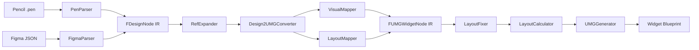

# Architecture

Chinese companion: [Architecture.zh-CN.md](Architecture.zh-CN.md)

Design2UMG converts design-side documents into Unreal Engine 5 UMG Widget Blueprints through a layered, source-agnostic pipeline.

## Pipeline



## Core Boundaries

- `PenParser` and `FigmaParser` are the only places that may interpret format-specific fields.
- `FDesignNode` is the shared design IR. Everything after parsing must operate on IR, not on source-specific JSON.
- `FUMGWidgetNode` is the generation IR used by editor-side Blueprint construction.
- `Design2UMGConverter` owns source-to-UMG conversion orchestration, while specialized helpers handle grid layout, prototype navigation, source metadata, and text widget construction.

## Design Rules

### Parser responsibility stays in the parser

If a fidelity problem comes from source data semantics, fix the responsible parser instead of adding broad runtime branches in shared layers.

### Bounds are the source of truth

Layout repair and projection are driven by bounds. `LayoutFixer` adjusts bounds-level intent, and `LayoutCalculator` turns the final bounds into anchors and offsets.

### Typed data is the primary contract

Generated widget data should flow through typed structs (`TextStyle`, `WidgetStyle`, `Text`, `Brush`, `Effect`, `Path`, `Shadow`, `Render`, `WidgetState`, `ScrollBox`) rather than ad hoc legacy property maps.

### Verification is part of the architecture

The formal release gate is not just "does it render" but "does no admissible case regress against the tracked historical best." Refactors are only acceptable if the full gate remains non-regressing.

## Module Overview

| Module | Responsibility |
| --- | --- |
| `Design2UMGCore` | Editor module for parsing, IR definitions, conversion, layout logic, and fidelity-related shared helpers. It is not a runtime module; the Core name means shared editor/importer ownership, not runtime availability. |
| `Design2UMGEditor` | Import pipeline, Blueprint generation, preview/editor UI, automation rendering, editor-only asset workflows |
| `Tools/` | Batch verification, historical-best validation, snapshot wrappers, release governance helpers |

## Release Boundary

- The public release promise covers `.pen` import and Figma design import through REST or local export JSON.
- Bridge/debug workflows such as MCP JSON import remain available but are not treated as the primary release contract.
- Local maintainer workflow files such as `AGENTS.md`, `CLAUDE.md`, `.claude/`, and `.codex/` should remain untracked and are excluded from packaged release outputs.

## Validation Boundary

- Public docs and public CI only promise the layers described in [ValidationProtocol.md](ValidationProtocol.md) and [ValidationGovernance/TestCoverageBoundary.md](ValidationGovernance/TestCoverageBoundary.md): `repository-hygiene` for public repo checks, contributor-facing smoke/repro commands, a manual self-hosted BuildPlugin job, and the separate maintainer formal admissible gate.
- Real-project validation is role-based, not machine-path-based. Public examples should use placeholders such as `<UE5_Root>`, `<PluginRoot>`, and `<MaintainerRuntimeProject.uproject>`.
- HostProject fallback is not an acceptable architecture or validation route. If a workflow needs a runtime project, it must use an explicit real UE project instead of creating or inferring a temporary host project.

For a plain-language summary of coverage layers and who can run them, see [ValidationGovernance/TestCoverageBoundary.md](ValidationGovernance/TestCoverageBoundary.md).

## Public API Boundary

The retained public header surface is intentional, but it is still a plugin API surface, not a runtime support promise.

`Source/Design2UMGCore/Public/` owns the shared parser, converter, settings, schema, font, notification, text measurement, layout, value parsing, and typed widget-node access contracts used across Core, Editor, and tests.

`Source/Design2UMGEditor/Public/` owns editor-only module, preview, remote image import, Figma/MCP/Pencil connector, preview widget/window, and JSON bridge contracts. These headers remain editor-facing and should not be treated as runtime module API.

Within that editor-facing surface there are two explicit buckets:

- stable editor workflow contracts:
  - preview service/window contracts
  - remote image import service
  - Figma / MCP / Pencil bridge entrypoints
- compatibility-retained bridge utilities:
  - `UMGJsonParser.h`
  - `UMGJsonSerializer.h`

The JSON bridge headers stay public for source compatibility and because preview/import/debug workflows still consume them, but they are not meant to imply a broad runtime support promise.

Headers that are kept public for bridge/debug utilities are documented as such. If a future change narrows one of them, it needs current include evidence, source-compatibility review, and validation.

## IR Data Flow

The pipeline uses two intermediate representations:

```
FDesignDocument  →  Design2UMGConverter  →  FUMGWidgetNode tree  →  UWidgetBlueprint
   (design IR)                                  (generation IR)
```

`FDesignDocument` is produced by parsers and holds source-agnostic design data. `FUMGWidgetNode` is produced by the converter and holds UMG-specific generation data. `UMGGenerator` consumes the node tree to produce the final Blueprint asset.

### FDesignNode children vs descendants

`FDesignNode::Children` is an ordered list of direct child nodes. `FDesignNode::Descendants` is a key-indexed lookup table for reusable nodes used during ref expansion — key format is either a slash-separated path (`"parentId/childId"`, resolved by recursive path traversal) or a bare node id (`"nodeId"`, resolved by full-tree id search); `RefExpander::ApplyDescendantOverride` selects the strategy based on whether the key contains `/`. `FDesignDocument::Children` is the root node list — same field name as `FDesignNode::Children` but different semantics. `FDesignDocument::FindReusableNode` traverses `Children` recursively and does not use `Descendants`.

### Parser decision fields in IR

Some fields such as `bPaddingRequiresRuntimeWrap` are set by the parser and consumed by the converter. This is intentional: the parser has access to source-format semantics (e.g. whether padding is already baked into child coordinates) that the converter cannot reconstruct. These fields represent parser decisions that must survive the IR boundary.

### Copy semantics

`FUMGWidgetNode` holds a `TUniquePtr<FUMGSourceNodeData>` and is move-only. It is a `USTRUCT`, and UHT-generated code does not support deep-copying `TUniquePtr` members, so copy construction is deleted. `FDesignNode` also holds a `TUniquePtr<FDesignSourceNodeData>` but implements a deep-copy constructor manually (see `DesignSchema.cpp`). The asymmetry is intentional: `FDesignNode` needs to be copyable for ref expansion, while `FUMGWidgetNode` does not.

## Extension Points

### Adding a new design source format

Implement a parser that produces a `FDesignDocument`. The required root payload is `Children` (the root node list), plus any document-level metadata the downstream pipeline depends on such as `Fonts`. Register the parser in `DesignSourceRegistry` (`Source/Design2UMGEditor/Private/Design2UMGEditorDesignSourceRegistry.cpp`).

Reference signatures:

```cpp
static bool FPenParser::ParseDocument(const FString& JsonString, FDesignDocument& OutDocument);
static bool FFigmaParser::ParseDocument(const FString& FigmaJson, FDesignDocument& OutDocument);
bool Design2UMGEditorDesignSourceRegistry::TryConvertSource(
    FName SourceId,
    const FString& RawJson,
    FUMGWidgetData& OutData);
```

Current registration shape lives in `Design2UMGEditorDesignSourceRegistry::RegisterBuiltInSources()` and uses:

```cpp
using FDesignSourceConvertFunc = TFunction<bool(const FString& RawJson, FUMGWidgetData& OutData)>;
void RegisterSource(FName SourceId, FDesignSourceConvertFunc&& Convert);
```

In practice, a new source format needs three edits:

1. Add a parser entry point in `Source/Design2UMGCore/Public/*.h` and parser implementation in `Source/Design2UMGCore/Private/*.cpp`.
2. Add a registry lambda in `Source/Design2UMGEditor/Private/Design2UMGEditorDesignSourceRegistry.cpp`.
3. Make the lambda parse into `FDesignDocument`, then hand that document to `DesignImportPipeline::AnalyzeImport(...).Data` so the registry output still includes converter output plus import-analysis side data.

### Adding a new Widget type mapping

1. Add a type mapping entry in `FDesignTypeMapper` (`Source/Design2UMGCore/Private/DesignTypeMapper.cpp`).
2. Add a typed-node handler function and register it in `GetPropsApplierMap()` inside the `UMGPropertyApplierInternal` namespace (`Source/Design2UMGEditor/Private/UMGPropertyApplierInternal.cpp`). Signature: `void(UWidget*, const FUMGWidgetNode&)`.
3. Add or reuse the narrow typed payload / request DTO that owns the behavior. Text, brush, render, widget style, widget state, and procedural resource flows already have typed owners.
4. To add new typed payload data, add a field or struct in `UMGSchemaTypedPayloads.h` and hold it from `FUMGWidgetNode` through the existing local typed payload pattern.

Reference signatures:

```cpp
static FString FDesignTypeMapper::MapNodeTypeToWidget(EDesignNodeType Type, EDesignLayout Layout);
const TMap<UClass*, FApplyPropsFunc>& GetPropsApplierMap();
void ApplyWidgetProperties(UWidget* Widget, const FUMGWidgetNode& Node);
```

Contributor checklist by scenario:

1. New design node kind -> widget class:
   - file: `Source/Design2UMGCore/Private/DesignTypeMapper.cpp`
   - function: `FDesignTypeMapper::MapNodeTypeToWidget(...)`
2. New widget that consumes current typed payloads:
   - file: `Source/Design2UMGEditor/Private/UMGPropertyApplierInternal.cpp`
   - function: `GetPropsApplierMap()`
3. New widget that needs a new typed owner or DTO:
   - file: `Source/Design2UMGEditor/Private/UMGPropertyApplierInternal.cpp`
   - functions: `GetPropsApplierMap()` and the relevant typed payload / request builder

### Extending the IR without breaking existing conversions

New fields in `DesignSchema.h` and adjacent transient schema bridges should prefer `TOptional<T>` with a default unset state when the current UE baseline supports and tests the optional property shape. On UE 5.7, `UPROPERTY()` and `TOptional` are supported for the raw-schema optional presence patterns used here, so new code must not add a parallel `Value + bHasValue` pair just to express set-vs-unset semantics. The converter checks `IsSet()` before processing optional fields, so unset fields are safely ignored by existing conversion paths.

Reference pattern:

```cpp
TOptional<float> Width;
TOptional<FMargin> Padding;
UPROPERTY() TOptional<bool> IsExposedInstance;
```

Do not introduce new `bHas*` + value shadow pairs into `DesignSchema.h`-style transient IR unless there is a documented serializer or typed-contract reason to keep that shape. Prefer `TOptional<T>` when you only need set-vs-unset presence. For existing typed payload structs in `UMGSchemaTypedPayloads.h`, follow the current local contract instead of forcing a blind `TOptional` rewrite.

## Known Issues

### TextMeasurement and FontResolver process-local state

`TextMeasurement` and `FontResolver` currently keep process-local cache/callback state. The shared state is guarded by locks and fits the normal editor import path, where imports are not treated as independent parallel jobs.

This is not a full architecture promise for parallel imports. If the product scope later requires concurrent import workers in the same editor process, this state must be reviewed as part of that design instead of assuming the current cache/callback boundary is already sufficient.

### UMGPropertyApplierInternal module placement

`UMGPropertyApplierInternal.cpp` stays in `Design2UMGEditor` for this release by design. The current supported product path is editor-side import and Widget Blueprint generation, so mutating `UWidget` instances belongs with the editor generation pipeline instead of becoming a Core public contract.

Re-evaluate this placement only if the supported product scope explicitly adds a runtime module, or if the `UWidget` mutation pipeline is split from editor-side generation into a separately supported runtime path. Until then, keep Core responsible for typed schema and narrow typed inspection/request helpers, and keep final `UWidget` mutation in the Editor module.
