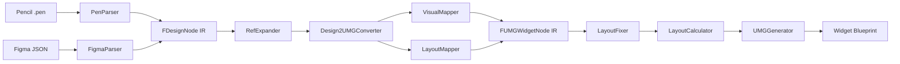

# Architecture

Design2UMG converts design-side documents into Unreal Engine 5 UMG Widget Blueprints through a layered, source-agnostic pipeline.

## Pipeline

## Core Boundaries

- `PenParser` and `FigmaParser` are the only places that may interpret format-specific fields.
- `FDesignNode` is the shared design IR. Everything after parsing must operate on IR, not on source-specific JSON.
- `FUMGWidgetNode` is the generation IR used by editor-side Blueprint construction.
- `Design2UMGConverter` owns source-to-UMG conversion orchestration, while specialized helpers handle grid layout, prototype navigation, source metadata, and text widget construction.

## Design Rules

### Parser responsibility stays in the parser

If a fidelity problem comes from source data semantics, fix the responsible parser instead of adding broad runtime branches in shared layers.

### Bounds are the source of truth

Layout repair and projection are driven by bounds. `LayoutFixer` adjusts bounds-level intent, and `LayoutCalculator` turns the final bounds into anchors and offsets.

### Typed data is the primary contract

Generated widget data should flow through typed structs (`TextStyle`, `WidgetStyle`, `Text`, `Brush`, `Effect`, `Path`, `Shadow`, `Render`, `WidgetState`, `ScrollBox`) rather than ad hoc legacy property maps.

### Verification is part of the architecture

The formal release gate is not just "does it render" but "does no admissible case regress against the tracked historical best." Refactors are only acceptable if the full gate remains non-regressing.

## Module Overview

| Module | Responsibility |
| --- | --- |
| `Design2UMGCore` | Editor module for parsing, IR definitions, conversion, layout logic, and fidelity-related shared helpers. It is not a runtime module; the Core name means shared editor/importer ownership, not runtime availability. |
| `Design2UMGEditor` | Import pipeline, Blueprint generation, preview/editor UI, automation rendering, editor-only asset workflows |
| `Tools/` | Batch verification, historical-best validation, snapshot wrappers, release governance helpers |

## Release Boundary

- The public release promise covers `.pen` import and Figma design import through REST or local export JSON.
- Bridge/debug workflows such as MCP JSON import remain available but are not treated as the primary release contract.
- Local maintainer workflow files such as `AGENTS.md`, `CLAUDE.md`, `.claude/`, and `.codex/` should remain untracked and are excluded from packaged release outputs.
