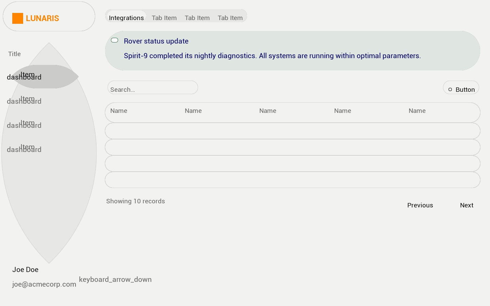
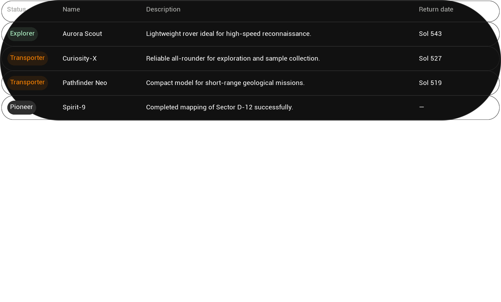

# Design2UMG

Convert design files to Unreal Engine 5 UMG Widget Blueprints. Supports [Pencil](https://pencil.evolves.dev/) `.pen` files, Figma (via REST API), and live Pencil MCP connection.




## Features

- **Multi-Source Input**: Import from `.pen` files, Figma REST API, or live Pencil MCP connection
- **Layout Engine**: CSS flexbox to UMG anchors/offsets with 9-grid anchor selection and hysteresis
- **Layout Fixer**: Auto-fix overflow, alignment snapping, equal spacing before anchor calculation
- **Visual Properties**: Fill, stroke, corner radius, box shadow, background blur, gradients
- **SVG Path Rasterization**: Full SVG path command set (M/L/H/V/C/Q/S/T/A/Z)
- **Component System**: Ref node expansion, design token/variable resolution, theme support
- **Text Styling**: Font size, weight, color, letter spacing, line height, alignment
- **Procedural Shapes**: Circle, ring, rounded rect, gradient textures
- **Drag & Drop**: Import `.pen` files directly from Content Browser
- **Live Sync**: Real-time design updates via MCP protocol (JSON-RPC 2.0 over SSE)
- **Preview Window**: Inspect and edit intermediate JSON before generation
- **Zero Runtime Dependencies**: Pure C++ / UE5 Engine API, editor-only plugin

## Requirements

- Unreal Engine 5.4+
- Pencil desktop app (optional, for live connection)
- Figma Personal Access Token (optional, for Figma import)

## Installation

Clone or copy this plugin to your engine or project plugin directory:

```
# Engine plugin
<UE5_Root>/Engine/Plugins/Marketplace/Design2UMG/

# Project plugin
<Project>/Plugins/Design2UMG/
```

Enable in Edit > Plugins > "Pen To UMG".

## Quick Start

5 步上手，从设计稿到可运行的 Widget Blueprint：

### Step 1 — 安装插件

将插件复制到引擎或项目插件目录（见上方 Installation），重启编辑器。首次启动会弹出 Welcome 对话框，设置设计分辨率和输出路径。

### Step 2 — 准备设计文件

使用 [Pencil](https://pencil.evolves.dev/) 创建设计，导出为 `.pen` 文件。插件附带两个示例文件可直接体验：

- `Examples/LoginForm.pen` — 登录表单（垂直布局、圆角卡片、按钮）
- `Examples/Dashboard.pen` — 仪表盘（水平卡片行、统计数据、嵌套布局）

### Step 3 — 导入

将 `.pen` 文件拖入 Content Browser，插件自动解析并弹出 Frame 选择器（多 Frame 时）。

也可通过控制台命令导入：
```bash
Design2UMG.Import Examples/LoginForm.pen
```

### Step 4 — 预览与调整

导入完成后，编辑器显示摘要通知（Widget 数量、耗时、警告）。有警告时弹出详情对话框。

在 Edit > Editor Preferences > Plugins > Pen To UMG 中可调整：
- 设计分辨率（Design Width / Height）
- 远程图片导入路径
- 字体自动导入开关
- 图标字体映射

### Step 5 — 生成 Widget Blueprint

导入成功后，Widget Blueprint 自动保存到输出路径（默认 `/Game/Design2UMG/`）。双击打开 UMG Designer 即可预览和编辑。

### 其他导入方式

**Figma 导入：**
```bash
Design2UMG.FigmaImport <file_key> <personal_access_token> [node_id]
```

**Pencil 实时同步：**
1. 打开 Pencil 桌面应用
2. UE5 编辑器中点击 Design2UMG 工具栏 > "Connect"
3. 选择 Frame — 设计变更实时同步

## Architecture

```
.pen / Figma API / Pencil MCP
    │
    ▼
PenParser / FigmaParser / PenMCPBridge
    │
    ▼
Design2UMGConverter
    ├── PenRefExpander (component refs)
    ├── PenVariableResolver (design tokens)
    ├── PenVisualMapper (fill, stroke, shadow)
    └── PenLayoutMapper (gap, padding, justify)
    │
    ▼
LayoutFixer (overflow, alignment, equal spacing)
    │
    ▼
LayoutCalculator (Bounds → Anchors/Offsets)
    │
    ▼
UMGGenerator → Widget Blueprint
```

Key principle: **Bounds is the single source of truth.** All layout works on pixel-coordinate Bounds, projected to UMG Anchors/Offsets at the end.

| Module | Responsibility |
|--------|---------------|
| `PenParser` | Parse `.pen` JSON into `FPenDocument` AST |
| `FigmaParser` | Parse Figma REST API JSON into `FPenDocument` |
| `Design2UMGConverter` | Transform Pen nodes to `FUMGWidgetNode` tree |
| `LayoutFixer` | Fix bounds overflow, alignment snapping, equal spacing |
| `LayoutCalculator` | 9-grid anchor selection with hysteresis, edge snapping |
| `UMGGenerator` | Create UWidget objects and Widget Blueprint asset |
| `PenMCPBridge` | MCP protocol handler (JSON-RPC 2.0 over SSE) |
| `DesignSourceRegistry` | Extensibility point for design tool backends |

## Settings

Edit > Editor Preferences > Plugins > Pen To UMG

| Setting | Description | Default |
|---------|-------------|---------|
| Design Width | UMG design resolution width | 1920 |
| Design Height | UMG design resolution height | 1080 |
| Enable Remote Image Import | Auto-download remote images | true |
| Remote Image Import Path | Save path for imported images | /Game/Design2UMG/ImportedImages |
| Remote Image Timeout | Download timeout (seconds) | 20 |
| MCP Server Path | MCP server path (blank = auto-discover) | |

## Supported Widget Types

`CanvasPanel` · `Overlay` · `HorizontalBox` · `VerticalBox` · `SizeBox` · `ScaleBox` · `Border` · `Image` · `TextBlock` · `Spacer` · `WidgetSwitcher`

## Known Limitations

- Complex nested component overrides may not fully resolve
- Gradients: basic H/V/Radial with two color stops (multi-stop + arbitrary angle planned)
- Box shadow clipped under ClipToBounds (SDF material fix planned)
- Non-circular ellipses approximate as capsule shape (path rasterization fix planned)
- Animation/interaction properties not yet converted

See [KNOWN_LIMITATIONS.md](KNOWN_LIMITATIONS.md) for details and [Docs/ROADMAP.md](Docs/ROADMAP.md) for the development plan.

## Contributing

See [CONTRIBUTING.md](CONTRIBUTING.md).

## License

[MIT](LICENSE)
