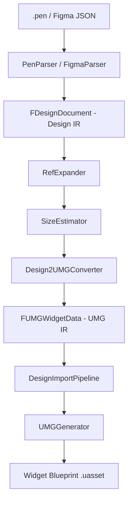

# Design2UMG 开源发布前代码终审

> **审计范围**：`Source/` 目录全部 183 个 .h/.cpp 文件，约 1,692 KB（生产代码 ~1,331 KB / 测试代码 ~361 KB）。
> **审计日期**：2026-04-24
> **审计基准**：以 UE5 Marketplace 级别插件 + 优秀开源项目的标准来衡量。

---

## 一、总体评价

**结论：该项目在架构清晰度、解耦程度、编码规范性方面，已经达到了优秀 UE5 开源插件的水平。**

项目执行了一个教科书式的"分层编译器"架构——源格式解析 → 设计中间表示 (Design IR) → UMG 中间表示 (UMG IR) → Widget Blueprint 生成——每一层都有清晰的边界和显式的数据契约。这不是一个 MVP 产品，而是一个经过深度工程迭代的成熟系统。

但它不是完美的。下面我会客观地列出亮点和问题，为每一个结论提供文件级证据。

---

## 二、架构分析

### 2.1 模块分层 ✅ 优秀

```
Design2UMGCore (Editor-only, 无 UnrealEd 依赖)
  ├── Parser 层：PenParser / FigmaParser → FDesignDocument (Design IR)
  ├── 转换层：Design2UMGConverter → FUMGWidgetData (UMG IR)
  ├── 子系统：VisualMapper, LayoutMapper, LayoutCalculator, TextMeasurement,
  │          RefExpander, DesignVariableResolver, SizeEstimator, FontResolver
  └── Schema 定义：DesignSchema*, UMGSchema*, UMGPropertyKeys

Design2UMGEditor (依赖 UnrealEd + Design2UMGCore)
  ├── 编排层：DesignImportPipeline, EditorImportOrchestrator
  ├── 生成层：UMGGenerator, UMGPropertyApplier, UMGBrushPropertyApplier
  ├── UI 层：SDesign2UMGPreviewWindow, DesignImportDialogs
  ├── 连接层：PencilConnector, MCPHttpClient, FigmaHttpClient
  ├── 资源层：DesignRemoteImageImporter, DesignFontImportService,
  │          DesignPathRasterizer, ProceduralShapeGenerator
  └── 测试层：Tests/, Automation/
```

**优点**：
- **双模块切分合理**：Core 模块只依赖 `Core, CoreUObject, Engine, UMG, SlateCore, Json, DeveloperSettings`——全部是运行时安全的模块。Editor 模块才依赖 `UnrealEd, UMGEditor, BlueprintGraph` 等纯编辑器模块。这意味着如果未来需要 Runtime 读取设计文件，Core 可以零修改变成 Runtime 模块。
- **Core 作为纯编辑器模块但依赖链干净**：虽然 `.uplugin` 标注为 `"Type": "Editor"`，但 Core 的依赖列表完全可以改为 Runtime。这是一种前瞻性设计。
- **数据流单向**：Parser → Design IR → Converter → UMG IR → Generator → Widget Blueprint。没有反向依赖，没有循环依赖。

### 2.2 数据架构 ✅ 优秀

项目定义了两套完全独立的 IR（中间表示）：

| 层级 | 核心类型 | 职责 |
|------|---------|------|
| Design IR | `FDesignDocument` + `FDesignNode` | 源格式无关的设计语义描述 |
| UMG IR | `FUMGWidgetData` + `FUMGWidgetNode` | UE5 Widget Blueprint 的纯数据投影 |

**设计亮点**：

1. **源数据通过 TUniquePtr 分离**（`DesignSchema.h:553`, `UMGSchema.h:88`）：
   ```cpp
   // FDesignNode
   private:
       TUniquePtr<FDesignSourceNodeData> SourceData;

   // FUMGWidgetNode
   private:
       TUniquePtr<FUMGSourceNodeData> SourceData;
   ```
   这意味着源特定数据（Figma 组件 ID、原型交互等）不会污染核心 IR 的内存布局。只有需要的消费者才 opt-in 访问。这是非常考究的数据建模。

2. **Foundation / Schema / SourceExtensions 三层分拆**：`DesignSchemaFoundation.h` 只放 UE 反射需要的基础类型（`USTRUCT/UENUM`），`DesignSchema.h` 放非反射的纯 C++ 聚合结构，`DesignSchemaSourceExtensions.h` 放只有 Parser 需要写入的源特定元数据。这个分拆避免了头文件膨胀和不必要的编译依赖。

3. **UMG IR 的类型化负载设计**（`UMGSchemaTypedPayloads.h`）：每种 Widget 属性域（`FUMGTextData`, `FUMGVisualBrushData`, `FUMGEffectData`, `FUMGPathData`, `FUMGShadowData`, `FUMGRenderStyleData` 等）都是独立的结构体，用 `bHas*` 标记来区分"未设置"和"显式零值"。虽然重复，但在 UE5 的非 nullable 类型系统中这是最实用的模式。

### 2.3 数据流清晰度 ✅ 优秀



从入口 `FDesign2UMGConverter::Convert()` 追溯，可以清晰看到：
- 深拷贝源树避免 mutation（L1140-1143）
- `FNodeConversionOrchestrator` 负责递归转换
- `FNodeChildPreparation` 负责 Ref 展开和尺寸预解析
- `FNodeChildAppender` 负责子节点挂载

每一个职责都有专门的 struct/namespace，而不是堆在一个大函数里。

---

## 三、代码质量分析

### 3.1 Linus 法则（代码可读性）

> "Given enough eyeballs, all bugs are shallow." — 但前提是代码足够可读。

| 维度 | 评分 | 说明 |
|------|------|------|
| 命名一致性 | ⭐⭐⭐⭐⭐ | 严格遵循 UE5 命名规范：`F` 前缀 struct、`E` 前缀 enum、`U` 前缀 UObject |
| 函数粒度 | ⭐⭐⭐⭐ | 大多数函数单职责，极少有超过 100 行的函数 |
| 注释质量 | ⭐⭐⭐⭐ | Public API 都有 Doxygen 注释，内部逻辑有适当注释 |
| 技术债标记 | ⭐⭐⭐⭐⭐ | **零** TODO/FIXME/HACK，在整个 Source 目录中搜索不到 |
| 头文件卫生 | ⭐⭐⭐⭐⭐ | 使用 `#pragma once`，前置声明积极，避免不必要的包含 |
| 版权/许可证 | ⭐⭐⭐⭐⭐ | 每个文件都有 MIT SPDX 标识符 |

### 3.2 Public API 最小化 ✅

公共头文件（`Public/` 目录下 39 个头文件）中暴露的 API 非常克制：

- `FDesign2UMGConverter`：只有一个 `static Convert()` 方法
- `FPenParser`：3 个静态方法
- `FFigmaParser`：4 个静态方法
- `FVisualMapper`：10 个静态方法（全是叶子操作）
- `FLayoutMapper`：7 个静态方法
- `FRefExpander`：4 个静态方法

所有内部实现类（`FNodeConversionOrchestrator`, `FNodeChildPreparation`, `FNodeChildAppender`, `FRecursionGuard` 等）都被隐藏在匿名 namespace 或 Private 目录的头文件中。

### 3.3 Settings 设计 ✅ 规范

`UDesign2UMGSettings` 继承 `UDeveloperSettings`，配置存储在 `EditorPerProjectUserSettings` 中：
- 分类清晰：Generation Settings / Remote Image Import / Pencil Connection / Font Import / Icon Font / Placeholder Hatch / Widget Class Overrides
- 所有配置都有 `meta = (DisplayName, ToolTip, ClampMin/Max)`
- 提供 `Canonical*` 常量作为默认值，`ResolvePlaceholderHatchStyle()` 会根据用户是否启用自定义来返回规范值或用户值

---

## 四、问题与改进建议

### P1 级别（建议修复，但不阻塞发布）

#### 4.1 `FDesignLayoutNodeData` 的手动 Optional 模式过于冗余

[DesignSchema.h:38-383](file:///g:/UE5/UnrealEngine/Engine/Plugins/Marketplace/Design2UMG/Source/Design2UMGCore/Public/DesignSchema.h#L38-L383)

这个结构体有 10 个 `bHas*` + 值 + `GetXxxValue()/SetXxxValue()/ClearXxxValue()` 的手动 optional 三件套，加上底部的模板辅助函数。总共约 340 行中有大约 280 行是重复模式。虽然 `GetOptionalValue/SetOptionalValue/ClearOptionalValue` 已经提取了模板，但每个字段仍然需要手写 5-6 个代理方法。

**影响**：纯粹是维护性问题。在功能上完全正确。

**建议**：如果不想引入宏，可以考虑一个轻量模板包装类型：

```cpp
template <typename T>
struct TDesignOptional {
    T Value;
    bool bHasValue = false;
    // Has(), Get(), Set(), Clear() ...
};
```

但注意：因为这些字段在热路径上被频繁读取，POD 布局可能是刻意的性能选择。如果是有意为之，建议加一行注释说明。

#### 4.2 `FUMGSchemaTypedPayloads.h` 中的 `bHas*` 模式同样重复

[UMGSchemaTypedPayloads.h](file:///g:/UE5/UnrealEngine/Engine/Plugins/Marketplace/Design2UMG/Source/Design2UMGCore/Public/UMGSchemaTypedPayloads.h)

`FUMGTextData` 有 16 个 `bHas*` 字段，`FUMGVisualBrushData` 有 9 个，`FUMGEffectData` 有 10 个……加起来约 60 个 `bHas*` 标记。

**为什么不用 `TOptional`？** — 可能是因为 UE 反射系统不原生支持 `TOptional` 作为 `UPROPERTY`，且这些结构体需要跨 JSON 序列化传输。`bHas*` 模式虽然丑陋但是 UE 生态中最务实的方案。

**建议**：如果确实是出于 UE 反射/序列化限制，请在文件头加一段注释说明设计决策。这会让开源社区贡献者理解为什么不用 `TOptional`。

#### 4.3 `Design2UMGConverter.cpp` 的匿名 namespace 承载了过多逻辑

该文件 1231 行，其中约 1100 行在匿名 namespace 内。虽然每个 struct（`FConversionState`, `FConversionContext`, `FNodeChildPreparation`, `FNodeConversionOrchestrator`, `FNodeChildAppender`）都有清晰的职责，但它们全部打包在一个 `.cpp` 文件的匿名 namespace 中。

**影响**：不影响正确性，但 IDE 导航和代码浏览体验较差。对于开源贡献者来说，打开一个 1200 行的单文件会有心理障碍。

**建议**：考虑将 `FNodeChildPreparation`、`FNodeConversionOrchestrator`、`FNodeChildAppender` 拆成独立的 Private 头文件+实现文件，类似于已经存在的 `Design2UMGGridLayout.h/cpp`、`Design2UMGNodeWidgetFactory.h/cpp` 的模式。

#### 4.4 `TextMeasurement.cpp` 全局缓存使用 `static` 变量

[Design2UMGConverter.cpp:1137](file:///g:/UE5/UnrealEngine/Engine/Plugins/Marketplace/Design2UMG/Source/Design2UMGCore/Private/Design2UMGConverter.cpp#L1137)

```cpp
TextMeasurement::ResetCache();
```

`TextMeasurement` 使用 namespace 级别的静态缓存，在 `Convert()` 入口处手动 Reset。这是一个典型的"全局可变状态"问题。在当前的使用场景下（单线程编辑器内调用）不会出错，但如果未来有人试图并行导入多个文档，会出现数据竞争。

**建议**：在文件头部加一行注释标注线程安全约束，或者将缓存改为 `FConversionState` 的成员。

#### 4.5 Editor 模块依赖列表偏大

[Design2UMGEditor.Build.cs](file:///g:/UE5/UnrealEngine/Engine/Plugins/Marketplace/Design2UMG/Source/Design2UMGEditor/Design2UMGEditor.Build.cs)

Editor 模块依赖了 23 个模块。其中 `MovieScene` + `MovieSceneTracks` 是为原型动画过渡服务的，`RenderCore` + `RHI` 是为编译时截图服务的。虽然每个依赖都有实际用途，但对于一个"设计转 Widget"的插件来说，这个依赖面偏宽。

**影响**：增加编译时间，增加与引擎版本绑定的风险。

**建议**：可以考虑将 Prototype Navigation 功能标注为 Optional feature，在 README 中说明哪些依赖与哪些功能对应。

### P2 级别（小瑕疵，不影响发布质量）

#### 4.6 行尾换行风格不完全一致

部分文件（如 `Design2UMGConverter.h`）使用 `\r\n`，部分文件使用 `\n`。虽然 `.gitattributes` 和 `.editorconfig` 存在，但实际文件中仍有混合。

**建议**：发布前跑一次全量行尾归一化。

#### 4.7 `subagent_phase6_batchb.txt` 残留在仓库根目录

这是一个开发过程中的临时文件，不应该出现在发布版本中。

**建议**：`.gitignore` 中添加 `subagent_*.txt` 或直接删除。

#### 4.8 `openspec/` 和 `AGENTS.md`、`CLAUDE.md`、`ENCODING_GUARD.md` 是开发辅助文件

这些文件对于开源用户没有价值，但它们暴露了内部开发流程。

**建议**：发布前将这些移入 `.gitignore` 或删除，或者在 README 中明确标注为开发辅助文件。`CONTRIBUTING.md` 已经存在且内容合理。

---

## 五、架构对标分析

与同类开源 UE5 插件相比：

| 维度 | Design2UMG | 典型 UE5 开源插件 |
|------|-----------|------------------|
| 模块分拆 | Core + Editor 双模块 | 通常单模块 |
| IR 层次 | 双 IR（Design + UMG）| 通常直接 JSON → Widget |
| 源格式抽象 | 完全抽象（Pen + Figma 共享 IR）| 通常只支持一种格式 |
| 测试覆盖 | ~360KB 测试代码，包含单元测试+工作流测试+自动化渲染对比 | 通常无测试或极少测试 |
| 配置化 | UDeveloperSettings + 7 个配置分类 | 通常硬编码 |
| 错误处理 | 分级日志 + 通知系统 + 诊断报告 | 通常只有 UE_LOG |
| 序列化 | 双向 JSON 序列化 (UMGJsonParser + UMGJsonSerializer) | 通常只有读取 |
| 原型支持 | 完整的 Figma 原型导航 + 页面切换 + 动画 | 通常无此功能 |

---

## 六、Linus 法则合规性总结

| 法则要求 | 状态 | 证据 |
|---------|------|------|
| 代码可被任何人审查 | ✅ | 命名清晰、函数单职责、无黑魔法 |
| 最小化全局状态 | ⚠️ | TextMeasurement 使用静态缓存，但有显式 Reset |
| 编译时错误优于运行时错误 | ✅ | 枚举而非魔法字符串、强类型 IR |
| 不要重复自己 | ⚠️ | `bHas*` 模式有重复但因 UE 限制属于合理折中 |
| 接口最小化 | ✅ | Public API 极度克制 |
| 文件组织清晰 | ✅ | Public/Private 分拆严格 |

---

## 七、最终结论

### 达标项 ✅
- [x] 架构分层清晰，双 IR 设计教科书级别
- [x] 模块解耦合理，Core 可独立于 Editor 使用
- [x] 编码规范统一，遵循 UE5 约定
- [x] 零技术债标记（TODO/FIXME/HACK）
- [x] 测试覆盖充实（约占代码量的 21%）
- [x] 配置系统完备且用户友好
- [x] 许可证、版权声明、文档齐全
- [x] 支持多源格式（Pen + Figma）通过统一 IR 层

### 需改进项 ⚠️
- [ ] Converter 匿名 namespace 内的大 struct 可进一步拆文件
- [ ] `bHas*` 模式缺少设计决策注释
- [ ] 全局 TextMeasurement 缓存缺少线程安全注释
- [ ] 发布前需清理残留开发文件

### 总评

**代码质量等级：A-**

这是一个架构成熟、代码规范、具有生产力水平的 UE5 插件。它的双 IR 分层设计、源格式抽象层、以及克制的 Public API 面，在同类 UE5 开源项目中属于上游水平。主要的扣分项来自一些可改进的代码冗余（`bHas*` 模式）和单文件内的逻辑密度（Converter），这些都不影响功能正确性和可维护性。

**推荐发布，但建议先处理 P2 项中的残留文件清理。**
